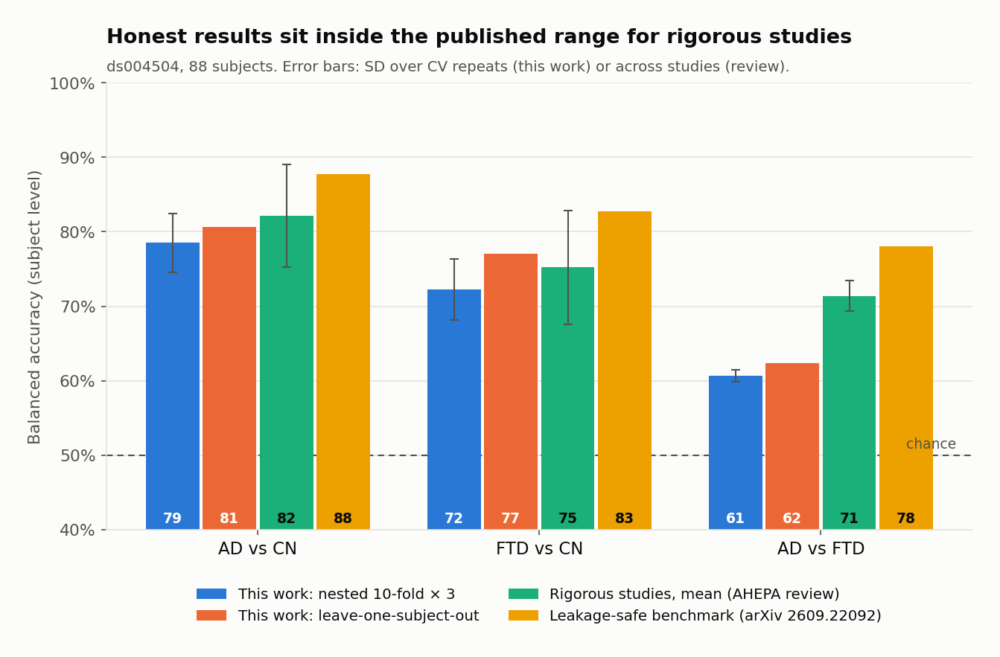
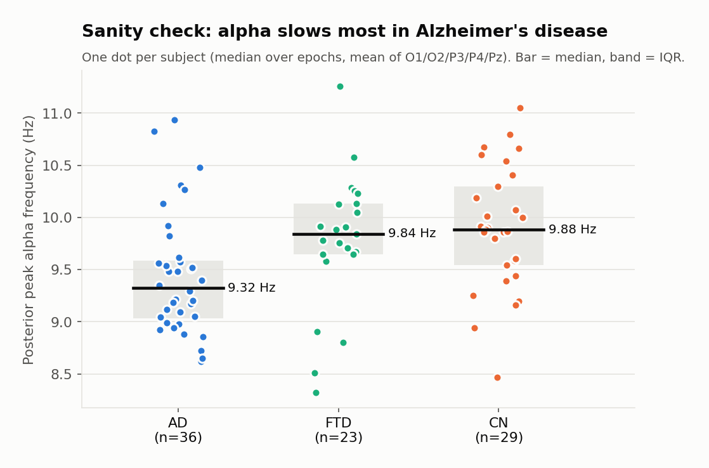
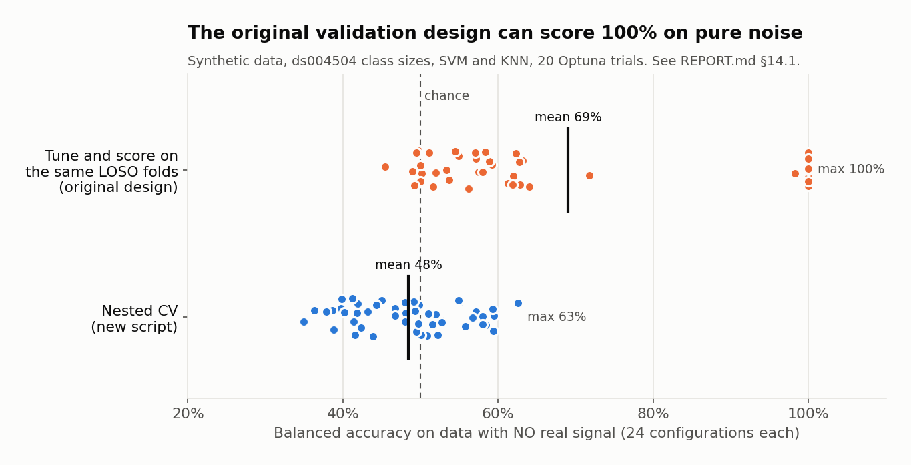
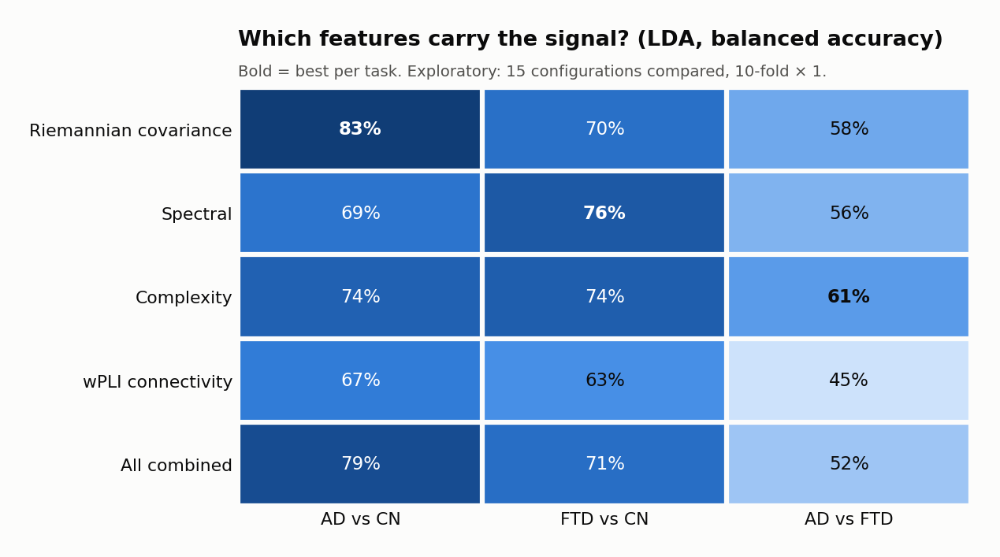
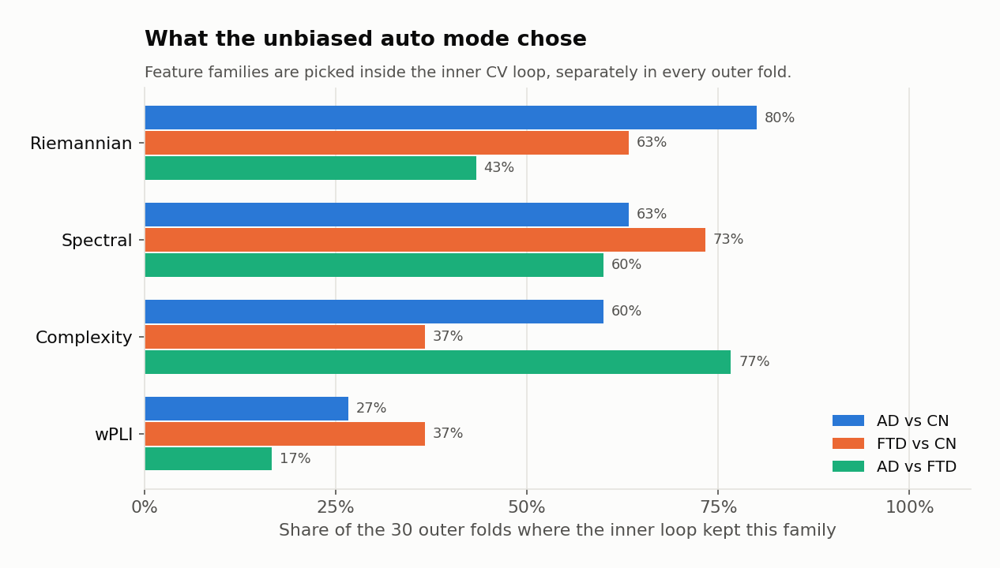
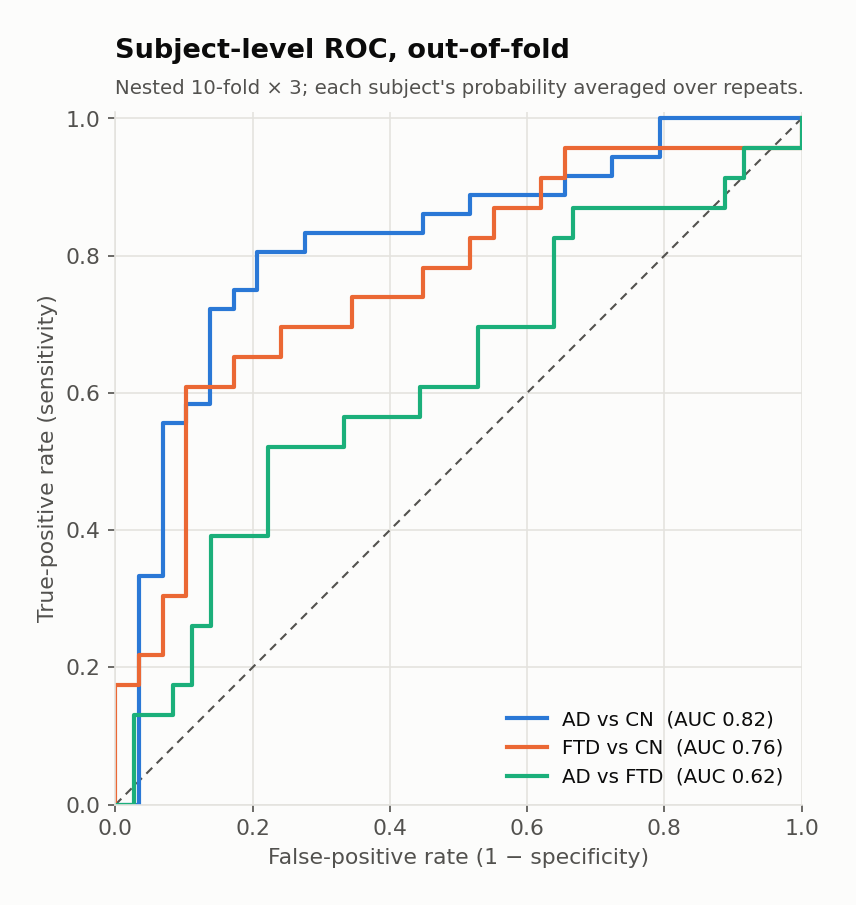

# EEG Dementia Classification: AD · FTD · Healthy Controls

**Resting-state EEG → physiologically grounded features → leakage-free, subject-level machine learning.**

This project classifies Alzheimer's disease (AD), frontotemporal dementia (FTD) and cognitively normal controls (CN) from 19-channel resting-state EEG, using the public OpenNeuro dataset [ds004504](https://openneuro.org/datasets/ds004504) (88 subjects). It covers the whole path from raw recordings to validated results in a single script. It's built around one principle: **every reported number must come from subjects the model never saw while being trained or tuned.**



| Task | Nested 10-fold × 3 | Leave-one-subject-out | AUC (LOSO) | Rigorous literature¹ |
|---|---|---|---|---|
| **AD vs CN** | 78.5 ± 4.0% | **80.6%** | 0.88 | 82.1 ± 6.9% |
| **FTD vs CN** | 72.3 ± 4.1% | **77.1%** | 0.78 | 75.2 ± 7.6% |
| **AD vs FTD** | 60.7 ± 0.8% | **62.4%** | 0.57 | 71.4% |

Balanced accuracy at the subject level. The model and the feature families are both chosen *inside* the inner cross-validation loop, so these numbers include the cost of picking the best pipeline. **Permutation test (AD vs CN):** 82.0% on the real labels vs a 46% mean on shuffled labels, p = 0.05 (19 permutations, the minimum p-value that number allows).
¹ Mean of studies rated "Validity 1" in the [AHEPA EEG benchmark review](https://pmc.ncbi.nlm.nih.gov/articles/PMC13184051/).

---

## Contents
- [Highlights](#highlights)
- [Pipeline](#pipeline)
- [Quick start](#quick-start)
- [Features](#features)
- [Validation design](#validation-design)
- [Results in detail](#results-in-detail)
- [Command reference](#command-reference)
- [Repository layout](#repository-layout)
- [The original script and why it was rewritten](#the-original-script-and-why-it-was-rewritten)
- [Limitations and next steps](#limitations-and-next-steps)
- [Data and references](#data-and-references)

## Highlights
- **End-to-end and reproducible:** `download` → `extract` → `classify`, all in one script, with the same results from the same seeds.
- **1,596 features per 10 s epoch, plus Riemannian covariances:**
  - spectral: band powers, slowing ratios, peak alpha frequency, aperiodic 1/f slope
  - complexity: entropies, fractal dimensions, Hjorth parameters
  - connectivity: debiased wPLI
- **No data leakage:**
  - nested, subject-grouped cross-validation
  - imputation, scaling, feature selection and the tangent-space mapping are all fitted on training folds only
- **No best-of-N inflation:** `auto` mode tunes the model and the feature families inside the inner loop.
- **Meaningful metrics:**
  - the disease is always the positive class
  - fixed subject-level metrics: balanced accuracy, sensitivity, specificity, F1, AUC
  - optional repeated CV and permutation p-values
- **Checked against the literature**, with every source cited in [REPORT.md](REPORT.md).

## Pipeline

```mermaid
flowchart LR
    A[OpenNeuro ds004504<br/>88 subjects, ASR+ICA cleaned] -->|download| B[EEGLAB .set files]
    B -->|extract| C[Band-pass 0.5–45 Hz<br/>average reference<br/>250 Hz]
    C --> D[10 s epochs, 50% overlap<br/>artifact rejection]
    D --> E[Spectral · Complexity<br/>wPLI · Covariances]
    E --> F[(features_ds004504.npz)]
    F -->|classify| G[Outer CV<br/>stratified group 10-fold or LOSO]
    G --> H[Inner CV + Optuna<br/>model · families · top-k · hyperparameters]
    H --> I[Fit on outer-train,<br/>score held-out subjects]
    I --> J[Subject-level metrics<br/>results.csv · summary.md]
```



## Quick start

```bash
git clone https://github.com/ZhipengHuang00/EEG-Project.git
cd EEG-Project
python3 -m venv .venv && source .venv/bin/activate
pip install -r requirements.txt

python eeg_bandwise_classification.py download                 # 2.8 GB, ~15 min
python eeg_bandwise_classification.py extract --n-jobs 6       # ~15 min → features_ds004504.npz
python eeg_bandwise_classification.py classify --quick         # ~1 min smoke test
python eeg_bandwise_classification.py classify --repeats 3 --n-jobs -1 --out-dir results/headline_auto
python scripts/make_figures.py                                 # rebuild figures/ from results/
```

| Step | Time on a 10-core laptop |
|---|---|
| `download` | ~15 min (2.8 GB) |
| `extract`, all 88 subjects | ~15 min |
| `classify`, headline (`auto`, 10-fold × 3, 3 tasks) | ~16 min |
| `classify --outer-folds 0` (LOSO) | ~1.7 h |
| `classify --permutations 19` (one task) | ~2 h |

> Python 3.9–3.12. On macOS, if LightGBM or XGBoost fail to import, run `brew install libomp`. Use a fresh virtual environment: `threadpoolctl` older than 3.1 (bundled with older Anaconda installs) crashes KNN.

## Features

Extracted per 10-second epoch (50% overlap) from the preprocessed recordings, with 6 frequency bands: δ 0.5–4, θ 4–8, α1 8–10, α2 10–13, β 13–30, γ 30–45 Hz.

| Family | What | Count | Why it matters |
|---|---|---|---|
| **Spectral** | log absolute and relative band power, θ/α ratio, slowing ratio (δ+θ)/(α+β), spectral entropy, **peak alpha frequency**, **aperiodic 1/f exponent and offset** | 342 | "EEG slowing" is the best-established AD marker; the aperiodic slope separates AD from FTD |
| **Complexity** | Hjorth mobility and complexity, permutation entropy, sample entropy, Higuchi and Katz fractal dimension | 114 | Dementia makes EEG more regular and less complex |
| **Connectivity** | debiased weighted phase-lag index (171 pairs × 6 bands) and node strength | 1,140 | Robust to volume conduction, unlike PLV or coherence |
| **Riemann** | 19×19 covariance per band, mapped to the Riemannian tangent space **inside each fold** | 6 × 190 | The strongest single family for AD vs CN |

**Epoch rejection:**
- peak-to-peak above max(150 µV, 2 × the subject's median peak-to-peak), or
- log-variance more than 3.5 robust SD from the subject's median
- The adaptive limit avoids discarding a whole high-amplitude recording. With a fixed limit, one AD patient would have lost 106 of 109 epochs.
- Overall, 12,603 of 13,831 epochs are kept (median 93% per subject).

**Excluded on purpose:** MMSE (a cognitive test score, part of the diagnosis, so it would leak the label). Age and sex are stored for reporting only.



*A sanity check before any modelling: posterior alpha is slower in AD (median 9.32 Hz) than in FTD (9.84 Hz) or CN (9.88 Hz), which matches the clinical literature.*

## Validation design

| Safeguard | How it's done |
|---|---|
| Subject-wise splits | `StratifiedGroupKFold` / `LeaveOneGroupOut` on subject IDs. No subject is ever in both training and test |
| Nested tuning | Optuna (TPE, 30 trials) on an inner 5-fold split of the outer-training subjects only |
| In-fold preprocessing | inf→NaN, mean imputation, standard scaling, `SelectKBest` (ANOVA-F or mutual information) or PCA, and the Riemannian tangent space are all inside the sklearn `Pipeline` |
| No selection bias | `--models auto` searches LogReg / LDA / SVM / RandomForest / FamilyVote **and** the feature families in the inner loop |
| Subject-level scoring | probabilities averaged per subject; positive class = disease (FTD in AD vs FTD) |
| Stability | `--repeats R` repeats the outer CV with new splits and reports mean ± SD |
| Significance | `--permutations N` shuffles labels between subjects and reruns the entire nested procedure |

Why this matters: on synthetic data with **no** signal, the original design (tuning and scoring on the same LOSO folds) scored up to **100%**. The nested design stays at chance.



## Results in detail

<table>
<tr>
<td width="50%"></td>
<td width="50%"></td>
</tr>
<tr>
<td valign="top"><b>Which features carry the signal.</b> Riemannian covariance is best for AD vs CN (83%), spectral for FTD vs CN (76%, AUC 0.85), complexity for AD vs FTD (61%). wPLI connectivity is the weakest family. Exploratory: 15 configurations, one repeat.</td>
<td valign="top"><b>What the unbiased search picked.</b> Inside the inner loop, the Riemannian family was kept in 80% of AD vs CN folds, spectral in 73% of FTD vs CN folds and complexity in 77% of AD vs FTD folds. Linear models (LDA, logistic regression) were chosen most often.</td>
</tr>
</table>

<p align="center"></p>

*Subject-level ROC curves from the headline run. Probabilities are averaged over the 3 repeats, so these AUCs (0.82 / 0.76 / 0.62) differ slightly from the tables, which report the mean AUC per repeat.*

**Other findings:**
- **Leave-one-subject-out vs 10-fold:** LOSO is 2–5 points higher. It trains on n − 1 subjects instead of 90%. Use it when comparing with papers, since most of them use it.
- **Brain-region averaging** (`--spatial regions`) gave the same accuracy: AD vs CN 79.6 ± 2.3%. The model is more compact but no more accurate.
- **AD vs FTD is the open problem.** Every family scores about 60%, against 65–78% reported by rigorous studies.

Every run folder in [`results/`](results) contains `summary.md`, `results.csv`, `subject_predictions.csv`, `best_params.jsonl` and `run_config.json`.

## Command reference

```text
eeg_bandwise_classification.py download [--out DIR] [--subjects N ...] [--n-jobs 8]
eeg_bandwise_classification.py extract  [--bids-root DIR] [--out FILE] [--subjects N ...] [--n-jobs -1]
eeg_bandwise_classification.py classify [options]
```

| `classify` option | Default | Meaning |
|---|---|---|
| `--data` | `features_ds004504.npz` | Features file. The original RBP/CPTE `.npz` layout is detected automatically |
| `--tasks` | all three | `AD_CN`, `FTD_CN`, `AD_FTD` |
| `--models` | `auto` | `auto`, `LogReg`, `LDA`, `SVM`, `RandomForest`, `FamilyVote`, `XGBoost`, `CatBoost`, `KNN`, `MLP`, `LightGBM` |
| `--feature-sets` | `all` | `all` or families joined with `+`, e.g. `spectral riemann spectral+complexity` |
| `--bands` | `all` | Keep only one band's features (`alpha` = alpha1 + alpha2), for band-by-band questions |
| `--unit` | `subject` | `subject` (median over epochs) or `epoch` (probabilities averaged per subject) |
| `--spatial` | `channels` | `regions` averages over frontal / temporal / central / parietal / occipital |
| `--outer-folds` | `10` | `0` = leave-one-subject-out |
| `--repeats` | `1` | Repeated outer CV (3–5 recommended) |
| `--inner-folds`, `--n-trials` | `5`, `30` | Inner tuning |
| `--permutations` | `0` | Label permutations for a p-value (100+ for a paper) |
| `--no-nested` | off | Reproduces the biased original design, for comparison only |
| `--n-jobs` | `1` | Parallel fold jobs (`-1` = all cores; BLAS threads are pinned to 1 per worker) |
| `--quick` | off | One-minute smoke test |

## Repository layout

```text
├── eeg_bandwise_classification.py   # download / extract / classify (the whole pipeline)
├── requirements.txt
├── scripts/
│   ├── make_figures.py              # regenerates figures/ from results/
│   └── make_synthetic_data.py       # synthetic data for the bias demonstration and tests
├── figures/                         # charts used in this README and REPORT.md
├── results/
│   ├── headline_auto/               # nested 10-fold × 3, auto (headline)
│   ├── loso_auto/                   # nested, leave-one-subject-out outer loop
│   ├── regions_auto/                # region-averaged features
│   ├── families/                    # per-family comparison (LDA)
│   ├── perm_adcn/                   # permutation test, AD vs CN
│   └── bias_demo_synthetic/         # nested vs non-nested on pure noise
├── REPORT.md                        # full technical report (code audit + methods + results)
├── DL56Bandwise.py                  # original script (kept unchanged for reference)
├── dl67 copy.py                     # earlier script already in this repo (unchanged)
└── FINALFTDVSCN.pdf                 # original connectivity figure
```

Not in git (rebuilt by the commands above): `data/` (raw EEG, 2.8 GB) and `features_ds004504.npz` (151 MB).

## The original script and why it was rewritten

`DL56Bandwise.py` is kept unchanged for reference. A line-by-line audit is in [REPORT.md](REPORT.md) §1–13. In short:
- **The scores were inflated.** Hyperparameters were tuned and scored on the same LOSO folds, and the best of 140 configurations was then reported. On noise this reaches 100%.
- **The F1 measured the wrong class.** F1, precision and recall treated healthy controls as the positive class.
- **Some settings did nothing.** Several "tuned" parameters (window, connectivity method, threshold) never changed the data.
- **Network features were dead code.** 105 of the 420 studies always scored 0.
- **The final model wasn't the tuned one.** `class_weight` was dropped when the final model was rebuilt.

The new script can still read the original `.npz` layout (`--rbp-layout band-major|channel-major`), so earlier feature files can be re-evaluated honestly.

## Limitations and next steps
- **Small cohort and one site:** 88 subjects from one clinic. A ±5-point difference is within noise, and no external validation has been done yet.
- **AD vs FTD is near 61%.** Next steps: frontal–posterior asymmetry features, band-specific Riemannian classifiers stacked inside the CV, and connectivity computed over the whole recording.
- **wPLI per 10 s epoch is noisy:** only 9 two-second segments go into each estimate.
- **Permutation test:** 19 permutations limit p to 0.05 or above. Use `--permutations 100` (about 10 h) before publishing.

## Data and references
- **Dataset:** Miltiadous A. et al. (2023). *A Dataset of Scalp EEG Recordings of Alzheimer's Disease, Frontotemporal Dementia and Healthy Subjects from Routine EEG.* Data 8(6):95. OpenNeuro [ds004504](https://openneuro.org/datasets/ds004504) (CC0).
- **Benchmark targets and methods:**
  - [AHEPA EEG benchmark review](https://pmc.ncbi.nlm.nih.gov/articles/PMC13184051/)
  - [Leakage-safe benchmarking (arXiv 2609.22092)](https://arxiv.org/html/2609.22092)
  - [Riemannian geometry for AD/FTD](https://pmc.ncbi.nlm.nih.gov/articles/PMC12782479)
  - [FC stacking, Sci Rep 2026](https://pmc.ncbi.nlm.nih.gov/articles/PMC12873302/)
  - [Periodic vs aperiodic EEG in AD](https://www.ncbi.nlm.nih.gov/pmc/articles/PMC10312609/)
- **Software:** MNE-Python, scikit-learn, Optuna, pyRiemann, AntroPy, SciPy, NumPy, pandas.

Full methods, the code audit and all numbers are in **[REPORT.md](REPORT.md)**.
