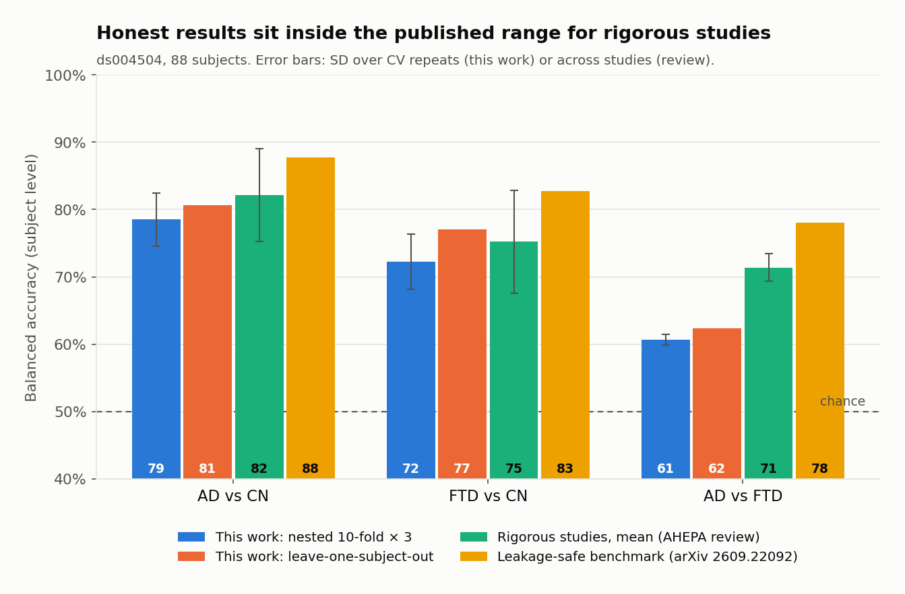
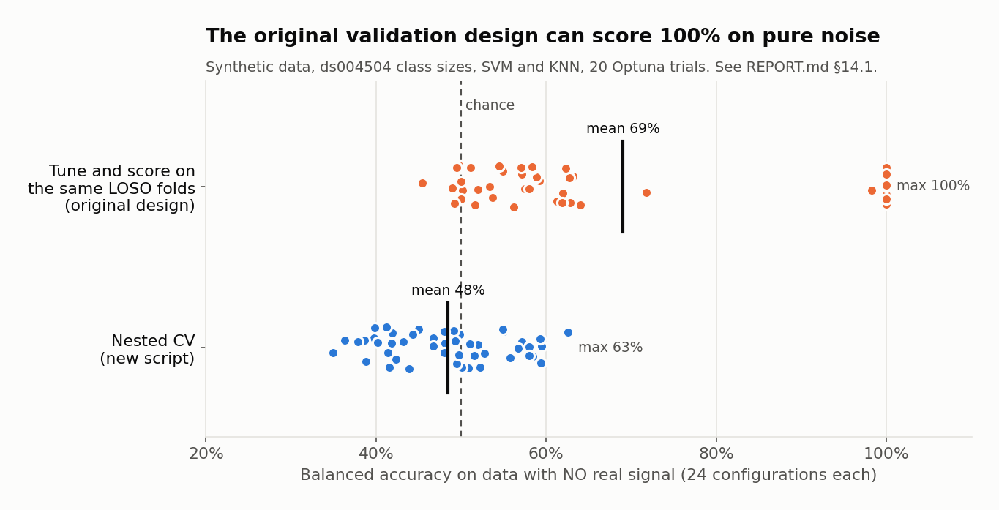
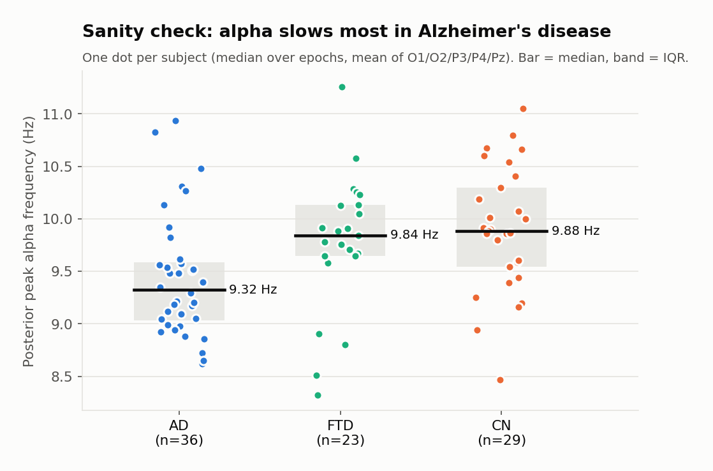
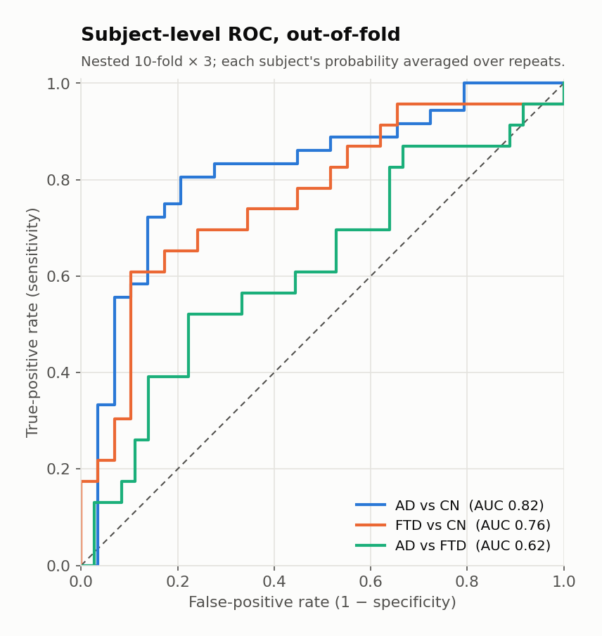
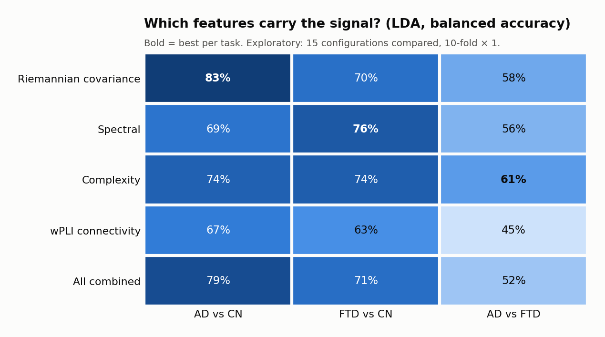
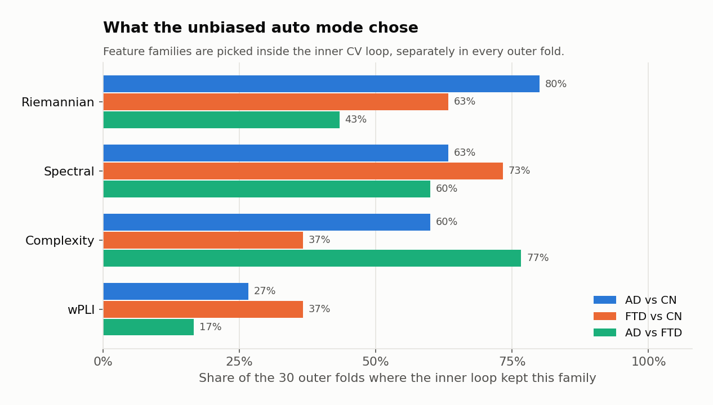

# EEG Dementia Classification: Technical Report

**Repo:** `Sepiboyboy/EEG_Research` (private, branch `main`)
**Analysed:** 2026-10-24 to 2026-10-25
**See also:** [README.md](README.md) for the quick start

---

## Executive summary

**What this project is:** classification of Alzheimer's disease (AD), frontotemporal dementia (FTD) and healthy controls (CN) from 19-channel resting-state EEG (OpenNeuro ds004504, 88 subjects).

**What was found in the original code (`DL56Bandwise.py`, sections 1–13):**
- **The validation inflates every score.** The same leave-one-subject-out folds were used both to tune hyperparameters and to report results, and the best of 140 configurations was then picked. On synthetic data with no signal at all, this design scored up to **100%** (section 14.1).
- **The metrics measured the wrong class.** In AD vs CN and FTD vs CN, F1, precision and recall described detecting *healthy controls*.
- **Four "tuned" parameters had no effect.** The final model dropped `class_weight`. A quarter of the 420 studies (the `network_only` ones) were dead code.

**What was built (`eeg_bandwise_classification.py`, sections 14–15):** one reproducible script with three commands.
- `download`: fetches ds004504.
- `extract`: computes 1,596 spectral, complexity and wPLI features plus Riemannian covariances per 10 s epoch.
- `classify`: nested, subject-grouped CV. All preprocessing and feature selection are fitted inside the folds, and an `auto` mode also picks the model and feature families inside the inner loop.

**Honest results** (subject-level balanced accuracy):

| Task | Nested 10-fold × 3 | Leave-one-subject-out | Rigorous literature |
|---|---|---|---|
| AD vs CN | 78.5 ± 4.0% | 80.6% (AUC 0.88) | 82.1 ± 6.9% |
| FTD vs CN | 72.3 ± 4.1% | 77.1% | 75.2 ± 7.6% |
| AD vs FTD | 60.7 ± 0.8% | 62.4% | 71.4% |

AD vs CN is significantly above chance: permutation p = 0.05, the minimum possible with 19 permutations; shuffled labels averaged 46%.



**Main takeaways:**
1. Rigorous validation, not a fancier model, decides whether a number can be trusted.
2. Riemannian covariance features are best for AD vs CN, and spectral features for FTD vs CN.
3. Simple linear models beat boosting.
4. AD vs FTD (about 61%) is the open problem.

---

## Table of contents
1. Repository overview
2. Data source
3. Dependencies (full list)
4. `DL56Bandwise.py`: architecture and data flow
5. `DL56Bandwise.py`: walkthrough by function
6. Hyperparameter search spaces
7. Experiment grid and compute cost
8. Output files
9. Issues found (validity, correctness, engineering)
10. Unused code
11. `FINALFTDVSCN.pdf`: figure analysis
12. How to run it
13. Recommended fixes, in priority order
14. Cleaned-up version: `eeg_bandwise_classification.py`
15. Research-backed upgrade and real results on ds004504

---

## 1. Repository overview

| File | Size | Lines | Purpose |
|---|---|---|---|
| `DL56Bandwise.py` | 38 KB | 699 | Tunes and evaluates classical ML classifiers on precomputed EEG features to tell apart Alzheimer's disease (AD), frontotemporal dementia (FTD) and healthy controls (CN), one frequency band at a time |
| `FINALFTDVSCN.pdf` | 203 KB | 1 page | A circular connectivity (chord) diagram, apparently comparing FTD with CN |

**Git history:** 3 commits, all named "Add files via upload" (`5d35dba`, `853e506`, `c90efe8`). The files were uploaded through the GitHub web interface rather than developed in the repo, so there is no development history to learn from.

**What's missing from the repo:**
- the input data `eeg_features_combined_phase_locking_10s_50.npz`
- the feature-extraction script that produced that file
- the script that generated the PDF figure
- a README, `requirements.txt`, and any results, logs or Optuna database

So this repo holds only the classification stage of a larger pipeline.

---

## 2. Data source

### 2.1 What the code names
The only source referenced anywhere in the code is:

```python
data_path = 'eeg_features_combined_phase_locking_10s_50.npz'   # line 658
```

Reading the filename:

| Part | Meaning |
|---|---|
| `eeg_features` | precomputed features, not raw EEG |
| `combined` | several feature families joined column-wise (RBP plus others) |
| `phase_locking` | connectivity computed with the phase-locking value (PLV); matches the constructor default `connectivity_method='phase_locking'` (line 153) |
| `10s` | 10-second analysis windows; matches `window_seconds=10` (line 152) |
| `50` | most likely the 0.5 threshold (`threshold=0.5`, line 154) used to build a binary connectivity graph. It could also mean 50% window overlap. |

**Arrays the NPZ file must contain:**

| Key | Required? | Meaning |
|---|---|---|
| `features` | required | 2-D float array. The first 95 columns are RBP; anything after that is treated as CPTE |
| `labels` | required | integers: 0 = AD, 1 = CN, 2 = FTD (line 123) |
| `subject_ids` | required | one subject ID per row, used for LOSO grouping |
| `cpte_features` or `cpte` | optional | extra CPTE columns |

### 2.2 What the code doesn't name
The code mentions no raw dataset, no paper, no URL and no acquisition details.

### 2.3 Likely original dataset (inferred)
Everything in the code matches the public OpenNeuro dataset **ds004504**: *"A dataset of EEG recordings from: Alzheimer's disease, Frontotemporal dementia and Healthy subjects"* (Miltiadous et al., *Data* 2023):
- 88 subjects: 36 AD, 23 FTD, 29 CN
- 19 scalp channels in the 10-20 system: Fp1, Fp2, F7, F3, Fz, F4, F8, T3, C3, Cz, C4, T4, T5, P3, Pz, P4, T6, O1, O2
- resting-state recordings with eyes closed

The code's three classes (AD / CN / FTD) and "5 bands × 19 channels" layout fit this exactly. **The code itself doesn't confirm this.** Check it against your feature-extraction script.

**What "CPTE" probably means:** the code never defines it. The acronym probably stands for something like a channel-wise permutation or transfer-entropy feature. Note it in the paper's methods section once it's confirmed.

---

## 3. Dependencies

### 3.1 Third-party packages imported directly

| pip package | Import in the code | Lines | What it's used for |
|---|---|---|---|
| **numpy** | `import numpy as np` | 5 | loading the NPZ file, slicing arrays, masks, NaN/Inf handling |
| **pandas** | `import pandas as pd` | 6 | only for building and writing the results CSV (lines 668–683) |
| **scikit-learn** | `sklearn.preprocessing.StandardScaler` | 7 | z-scoring features inside each fold |
| | `sklearn.impute.SimpleImputer` | 8 | mean imputation of NaN values |
| | `sklearn.ensemble.RandomForestClassifier` | 9 | Random Forest model |
| | `sklearn.svm.SVC` | 10 | Support Vector Machine model |
| | `sklearn.metrics` (`accuracy_score`, `f1_score`, `precision_recall_fscore_support`) | 13 | evaluation metrics (`f1_score` is imported but never used) |
| | `sklearn.decomposition.PCA` | 14 | optional dimensionality reduction |
| | `sklearn.neighbors.KNeighborsClassifier` | 22 | k-nearest-neighbours model |
| | `sklearn.neural_network.MLPClassifier` | 23 | multilayer perceptron model |
| **xgboost** | `from xgboost import XGBClassifier` | 12 | XGBoost gradient boosting |
| **catboost** | `from catboost import CatBoostClassifier` | 21 | CatBoost gradient boosting |
| **lightgbm** | `import lightgbm as lgb` | 24 | LightGBM gradient boosting |
| **optuna** | `import optuna`, `optuna.samplers.TPESampler`, `optuna.pruners.MedianPruner` | 15–17 | hyperparameter search |

### 3.2 Packages pulled in indirectly (needed at runtime)

| Package | Pulled in by | Why it's needed |
|---|---|---|
| **SQLAlchemy** | optuna | `storage='sqlite:///eeg_optuna_studies.db'` (line 532) |
| **alembic** | optuna | database schema migrations for that storage |
| **tqdm** | optuna | `show_progress_bar=True` (line 536) |
| **colorlog** | optuna | Optuna's own logging |
| **scipy**, **joblib**, **threadpoolctl** | scikit-learn | numerical routines and parallel work (`n_jobs=-1`) |
| **scipy**, **graphviz**, **matplotlib**, **plotly** | catboost | installed with CatBoost's wheel; not used by this script |
| **libomp** (system library) | lightgbm, xgboost on macOS | OpenMP runtime. Install with `brew install libomp` if importing LightGBM or XGBoost fails |

### 3.3 Standard library
`os` (imported but never used), `logging`, `datetime`, `typing` (`Tuple`, `Dict`, `Any`, `Optional`) and `warnings`.

### 3.4 Version notes
- **Python:** 3.9–3.12 should work. Wheels for CatBoost, LightGBM and XGBoost can lag behind the newest Python releases.
- **XGBoost ≥ 2.0:** `use_label_encoder=False` (lines 478 and 615) is deprecated and ignored with a warning. Remove it.
- **Optuna ≥ 3.0:** `TPESampler(multivariate=True, group=True)` is still flagged as experimental and prints an `ExperimentalWarning`, which the script hides. Passing tuples as categorical choices for `mlp_hidden_layer_sizes` (line 488) triggers a warning, and values read back from SQLite may come back as lists.
- **Your Mac right now:**
  - Python 3.9.21
  - numpy 1.25.2, pandas 1.4.4, scikit-learn 1.1.3, optuna 4.4.0, SQLAlchemy 2.0.37
  - **xgboost, catboost and lightgbm are not installed**, so the script would fail at import.

### 3.5 `requirements.txt`
A `requirements.txt` with these packages has been added next to the script (see section 12).

---

## 4. `DL56Bandwise.py`: architecture and data flow

```
eeg_features_combined_phase_locking_10s_50.npz
        │  np.load
        ▼
EEGDataPreprocessor.load_data()
   features[:, :95]  ──► X_rbp      (5 bands × 19 ch)
   features[:, 95:]  ──► X_cpte     (+ optional 'cpte_features' / 'cpte')
   (network)         ──► X_network  (EMPTY, disabled)
   labels, subject_ids
        │
        ▼
EEGClassifier.create_datasets()
   3 binary tasks: AD_CN, FTD_CN, AD_FTD (mask + relabel)
        │
        ▼
run_pipeline()  ── for band × task × model × feature_set (420 combos)
        │
        ├─ Optuna study (TPE, 50 trials, SQLite)
        │     objective_wrapper_fixed()
        │        slice features to the band
        │        build the model from sampled hyperparameters
        │        evaluate_model_ml(): LOSO CV
        │            per fold: Inf→NaN → mean-impute → z-score → [PCA] → fit → predict
        │        return F1
        │
        └─ rebuild the best model → evaluate_model_ml() again → store metrics
        │
        ▼
main(): results → CSV + log
```

---

## 5. Walkthrough by function

### 5.1 Module setup (lines 1–45)
- **Logging (lines 27–35):** writes to both the console and `eeg_classification_ml_<YYYYMMDD_HHMMSS>.log` in the current directory. The log file is created **as soon as the module is imported**, not only when `main()` runs.
- **Warnings (lines 38–39):** `warnings.filterwarnings('ignore')` turns off every warning for the whole process.
- **`RBP_FEATURE_COUNT = 95` (line 45):** the only layout constant.

### 5.2 `EEGDataPreprocessor` (lines 49–138)
- **`__init__`:** stores the data path.
- **`load_data()` (lines 54–112):**
  1. `np.load(..., allow_pickle=True)`. Allowing pickle is needed only for object arrays, but it lets a malicious file run code when loaded. That's acceptable for your own data.
  2. Reads `features`, `labels` and `subject_ids`, plus the optional `cpte_features` or `cpte` array.
  3. Casts the types: features and CPTE to `float64`, labels to `int`, IDs to `str`.
  4. Splits the columns:
     - fewer than 95 columns: logs an error, uses everything as RBP, and leaves CPTE empty
     - otherwise: columns `[:95]` become RBP and columns `[95:]` become CPTE
  5. Sets the network block to an empty array of shape `(n, 0)`.
  6. Joins the CPTE taken from `features` with any CPTE array stored separately in the file.
  7. Logs summary information and returns 6 arrays.
  - **The docstring (lines 55–61) is out of date.** It still describes "Network (next 105)".
- **`_log_data_info()` (lines 114–138):** logs:
  - the row count, which is labelled "subjects"
  - the column counts for each feature block
  - the class distribution, using the mapping `{0:'AD', 1:'CN', 2:'FTD'}`
  - NaN and Inf counts
  - global mean, standard deviation, minimum and maximum, computed with `nan*` functions after converting Inf to NaN

### 5.3 `EEGClassifier.__init__` (lines 144–181)
- Stores all the feature blocks and the feature-extraction metadata (window, method, threshold), which is used only for logging.
- **Working out the CPTE band size (lines 168–170):** if the CPTE column count divides by 5, it assumes `n/5` columns per band. Otherwise per-band slicing of CPTE is turned off.
- `model_configurations` (lines 172–179) is defined but never used.
- `feature_set_choices = ['rbp_only', 'cpte_only', 'network_only', 'combined']`
- `band_choices = ['delta', 'theta', 'alpha', 'beta', 'gamma']`

### 5.4 `create_datasets()` (lines 183–231)
Builds a boolean mask for each task and relabels the classes:

| Task | Rows kept | Label 0 | Label 1 |
|---|---|---|---|
| `AD_CN` | AD, CN | AD | **CN** |
| `FTD_CN` | FTD, CN | FTD | **CN** |
| `AD_FTD` | AD, FTD | AD | **FTD** |

For each task it stores 4 feature sets. The `combined` set (RBP + network + CPTE, all bands) is **built but never used**, because the objective rebuilds a band-specific combined set instead.

### 5.5 Band slicing (lines 234–262)
- `BAND_TO_IDX = {delta:0, theta:1, alpha:2, beta:3, gamma:4}`
- **`_slice_rbp_by_band`:** returns columns `[19·i : 19·(i+1)]`. This assumes the columns are laid out band by band (all 19 channels for delta, then all 19 for theta, and so on). If the extraction script stored them channel by channel instead, **every "band" result would mix bands**. This needs checking.
- **`_slice_cpte_by_band`:** returns the same kind of contiguous block of size `cpte_band_size`. If the size is unknown, it returns **all** CPTE columns for every band and logs a warning, but that warning is hidden.

### 5.6 `evaluate_model_ml()`: LOSO cross-validation (lines 265–371)
For each unique subject:
1. Splits off the train and test rows. Rows from the same subject never end up on both sides, which is correct.
2. Skips the fold and records NaN predictions in three cases:
   - the train or test set is empty
   - the training set has only one class
   - there are no feature columns
3. **Preprocessing, fitted on the training fold only (no leakage here):**
   - `np.nan_to_num(posinf=nan, neginf=nan)`
   - `SimpleImputer(mean)`
   - `StandardScaler`
   - optionally `PCA(n_components=pca_variance)`, which keeps enough components to explain that share of the variance
4. Fits and predicts. Any exception produces NaN predictions.

After all folds:
- NaN predictions are removed.
- The averaging method is chosen:
  - `binary` if the true and predicted label sets are both exactly {0, 1}
  - `macro` if there are more than 2 true classes
  - `weighted` otherwise
- Returns `(accuracy, precision, recall, f1)`.

The same `model` object is refit on every fold. That's fine because sklearn's `.fit()` resets the model.

### 5.7 `objective_wrapper()` (lines 373–381)
This is old code that is never called. It would sample `feature_set_type` and always use the delta band.

### 5.8 `objective_wrapper_fixed()`: the Optuna objective (lines 382–512)
1. Samples the shared parameters (see section 6). Several of them have no effect.
2. Gets the task data and slices it by `feature_set_type` and `band`:
   - `combined` = the RBP band block + network (empty) + the CPTE band block
3. If there are no columns, returns 0.0.
4. Builds the model from the parameters sampled for that model type.
5. Runs LOSO and returns **F1**. It also saves `feature_params` as a trial user attribute.

### 5.9 `run_pipeline()` (lines 515–653)
Four nested loops: `band → task → model → feature_set`. For each combination it:
1. Creates or loads an Optuna study named `{task}_{model}_{featureset}_{band}_study` in SQLite, using `TPESampler(seed=42, multivariate=True, group=True)` and a `MedianPruner`.
2. Runs `study.optimize(..., n_trials)`.
3. Maps the prefixed Optuna parameter names (such as `rf_n_estimators`) back to the model's own argument names. **`class_weight` is dropped here.**
4. Rebuilds the features and model with the best parameters, then runs LOSO again using the best trial's `use_pca` and `pca_variance`.
5. Stores accuracy, precision, recall, F1, the best parameters and the feature parameters, keyed by `(task, model, feature_set, band)`.

### 5.10 `main()` (lines 655–697)
Loads the data, runs `run_pipeline(n_trials=50)`, writes the CSV and logs every configuration. Any exception is logged and then re-raised.

---

## 6. Hyperparameter search spaces

### 6.1 Shared parameters (sampled in every trial)

| Parameter | Range | Actually used? |
|---|---|---|
| `window_seconds` | {4, 6, 8, 10, 12} | **No.** Only logged |
| `connectivity_method` | {pearson, phase_locking, wpli_debiased} | **No.** Only logged |
| `threshold` | 0.3–0.8, step 0.1 | **No.** Only logged |
| `frequency_band` | {delta … gamma} | **No.** The band comes from the outer loop |
| `class_weight` | {balanced, None} | Only by RF and SVM, and only during trials |
| `use_pca` | {True, False} | Yes |
| `pca_variance` | 0.85–0.999 (only when `use_pca` is True) | Yes |

### 6.2 Model-specific parameters

| Model | Parameter | Range | Fixed settings |
|---|---|---|---|
| **RandomForest** | `n_estimators` | 50–200 | `random_state=42`, `n_jobs=-1` |
| | `max_depth` | 3–20 | |
| | `min_samples_split` | 2–10 | |
| | `min_samples_leaf` | 1–4 | |
| **SVM** | `C` | 0.01–100 (log scale) | `random_state=42` |
| | `kernel` | {rbf, linear} | |
| | `gamma` | {scale, auto} (rbf only) | |
| **CatBoost** | `iterations` | 50–200 | `verbose=0`, `random_seed=42` |
| | `depth` | 3–10 | |
| | `learning_rate` | 0.01–0.3 (log scale) | |
| | `l2_leaf_reg` | 1–10 | |
| **XGBoost** | `n_estimators` | 50–200 | `eval_metric='logloss'`, `random_state=42` |
| | `max_depth` | 3–10 | |
| | `learning_rate` | 0.01–0.3 (log scale) | |
| | `subsample` | 0.5–1.0 | |
| | `colsample_bytree` | 0.5–1.0 | |
| **KNN** | `n_neighbors` | 3–15 | |
| | `weights` | {uniform, distance} | |
| | `p` | {1 (Manhattan), 2 (Euclidean)} | |
| **MLP** | `hidden_layer_sizes` | {(50,), (100,), (100, 50)} | `max_iter=300`, `random_state=42` |
| | `activation` | {relu, tanh} | |
| | `alpha` | 1e-5–1e-1 (log scale) | |
| | `learning_rate` | {constant, adaptive} | |
| **LightGBM** | `n_estimators` | 50–200 | `random_state=42` |
| | `learning_rate` | 0.01–0.3 (log scale) | |
| | `max_depth` | 3–10 | |
| | `num_leaves` | 20–100 | |

**Notes:**
- **LightGBM** keeps its default `min_child_samples=20`. With only about 50–65 training subjects per task, many splits are impossible, and LightGBM can end up learning almost nothing. You won't see its "no further splits" warnings because all warnings are hidden.
- **`num_leaves` can exceed what `max_depth` allows.** A tree of depth 3 can have at most 8 leaves, but the search allows up to 100, so much of that range is wasted.
- **No class balancing for most models.** CatBoost, XGBoost, LightGBM, KNN and MLP get no class balancing even though the classes are uneven (for example 23 FTD vs 29 CN).

---

## 7. Experiment grid and compute cost

| Dimension | Count |
|---|---|
| Bands | 5 |
| Tasks | 3 |
| Models | 7 |
| Feature sets | 4 |
| **Optuna studies** | **420** (105 of them `network_only`, which always return 0) |
| Trials per study | 50, plus 1 final re-evaluation |
| LOSO folds per trial | one per subject in the task. With ds004504 that would be AD_CN = 65, FTD_CN = 52, AD_FTD = 59 |

**Total model fits:** 315 useful studies × 51 evaluations × about 59 folds ≈ **950,000 fits**.
- RF with up to 200 trees, the boosted models and MLP make up most of that.
- Expect **many hours to several days** on a laptop.
- The loops run one after another. Only RF uses multiple cores (`n_jobs=-1`).
- **If the NPZ file stores one row per 10-second window** rather than one per subject, there are about 30–80 times more training rows, and the runtime grows by the same factor.

---

## 8. Output files
All of these are written to the current working directory:

| File | Content |
|---|---|
| `eeg_classification_ml_<timestamp>.log` | the full run log, including every trial's parameters |
| `eeg_optuna_studies.db` | a SQLite database holding all 420 Optuna studies |
| `eeg_classification_results_with_feature_selection.csv` | one row per (task, model, feature set, band): Accuracy, Precision, Recall, F1_Score, Best_Params, Feature_Params |

---

## 9. Issues found

### A. Validity: these affect the numbers you'd publish

**A1. Optimistic bias: no nested cross-validation (severe).**
- Hyperparameters are tuned to maximise LOSO F1 (line 509).
- The "final" score is computed again on the same subjects with the same LOSO procedure (lines 637–640), so it's essentially the best trial's score.
- Picking the best of 140 configurations per task, with 50 trials each, adds a second layer of selection bias. With about 50–65 subjects this bias can easily be 10–20 percentage points.
- *Fix:* use nested LOSO, with tuning in an inner loop and scoring in the outer loop. Alternatively, keep a held-out set of subjects. Report how many configurations were searched, or run a permutation test.

**A2. The F1 score measures the wrong class (major).**
- With `average='binary'`, sklearn scores the class labelled 1.
- In AD_CN and FTD_CN, label 1 is **CN (healthy)** (lines 215–216). The reported F1, precision and recall therefore describe how well healthy controls are detected, not patients.
- *Fix:* label the disease as 1, or pass `pos_label`.

**A3. The averaging method changes between runs (major).**
- Lines 349–353 switch between `binary` and `weighted` depending on whether the model predicted both classes. A study that collapses to predicting a single class is scored with weighted averaging.
- Scores from different studies are therefore not directly comparable.
- *Fix:* use one fixed method. Report balanced accuracy, sensitivity, specificity and ROC-AUC as well.

**A4. Parameters that look tuned but don't do anything (major, misleading).**
- `window_seconds`, `connectivity_method`, `threshold` and `frequency_band` (lines 389–400) never change the data.
- They show up in the CSV as "Feature_Params", which implies they were optimised. If they're reported as tuned, the methods section would be wrong.
- They also slow down TPE by adding noise dimensions.
- *Fix:* remove them, or actually regenerate the features for each value.

**A5. The final model isn't the one that was tuned (moderate).**
- Trials pass `class_weight` to RF and SVM (lines 448 and 460).
- The rebuilt `best_params` (lines 539–587) leave it out, so the final RF and SVM (lines 609 and 611) always use `class_weight=None`.
- The reported score can therefore differ from the best trial's score.
- *Fix:* keep `class_weight` in the rebuilt parameters, or store `study.best_value` and the best trial's own model.

**A6. Feature-layout assumptions are never checked (major risk).**
- **RBP:** the slicing assumes the columns are grouped by band (lines 236–248). If they're actually grouped by channel, every "band" result is wrong.
- **Network vs CPTE:** the docstring says columns 96–200 are network features, but the code calls everything after column 95 "CPTE" (line 91). If those columns really are network features:
  - the "CPTE" results are actually network results
  - CPTE band slicing would split network edges into five arbitrary chunks
- **CPTE band size:** if the CPTE column count doesn't divide by 5, every band gets all CPTE columns, so the five "bands" are identical.
- *Fix:* save the column names in the NPZ file, for example `feature_names = ['rbp_delta_Fp1', …]`, and slice by name.

**A7. Results depend on whether rows are subjects or windows.**
- Line 116 logs the row count as "subjects". If rows are 10-second windows, LOSO still groups correctly by `subject_ids`.
- But in that case accuracy is computed **per window**, so subjects with longer recordings count for more. Clinical results are usually reported per subject.
- *Fix:* add up the window predictions for each subject (majority vote or mean probability) and score at the subject level.

### B. Correctness and engineering

| # | Issue | Lines | Effect | Fix |
|---|---|---|---|---|
| B1 | `MedianPruner` never prunes | 531 | the objective never calls `trial.report()`, so no time is saved | remove it, or report fold scores as they finish |
| B2 | `load_if_exists=True` | 532 | a rerun adds 50 more trials to each existing study, so results aren't reproducible | delete the `.db` file first, or put a run ID in `study_name` |
| B3 | failed folds are silently dropped | 285–306, 336–339 | subjects disappear from the metrics without notice | count the dropped subjects and report them |
| B4 | all warnings hidden | 38–39 | hides MLP convergence failures, LightGBM split warnings and Optuna warnings | suppress only specific warnings |
| B5 | `network_only` is dead | 93–94, 180 | 105 studies return 0.0 and fill the CSV with junk rows | remove it from `feature_set_choices` |
| B6 | `use_label_encoder` | 478, 615 | deprecated in XGBoost 2.x | delete it |
| B7 | tuples as categorical choices | 488 | Optuna warning; values read back from SQLite may be lists | encode them as strings such as `"100-50"` and parse them back |
| B8 | the log file is created on import | 27–34 | importing the module creates a stray log file | set up logging inside `main()` |
| B9 | `allow_pickle=True` | 64 | loading an untrusted NPZ file could run code | set it to False unless object arrays are needed |
| B10 | the data path is hard-coded | 658 | can't run a different feature file without editing the code | add command-line arguments for the path and trial count |
| B11 | misleading name "DL56" | file | there is no deep learning, only sklearn's MLP | rename it, for example to `ml_bandwise_loso.py` |
| B12 | the label mapping is "assumed" | 123 | a wrong mapping would mislabel every result | store the label names in the NPZ file |
| B13 | no saved models or predictions | none | the results can't be analysed afterwards (confusion matrices, ROC curves, per-subject errors) | save the out-of-fold predictions |

---

## 10. Unused code

| Item | Line(s) |
|---|---|
| `import os` | 4 |
| `f1_score` import | 13 |
| `model_configurations` list | 172–179 |
| `objective_wrapper()` | 373–381 |
| `datasets[task]['combined']` (all bands) | 225–229 |
| `X_combined` passed to `EEGClassifier` | 146, 156 |
| `else` branch at line 605 (can't be reached) | 604–605 |

---

## 11. `FINALFTDVSCN.pdf`: figure analysis

**Type:** a circular connectivity (chord) diagram, probably made with MNE-Python's `plot_connectivity_circle` or a similar tool. The page is rotated 90°.

**Electrodes shown (14):** Fp1, Fp2, F3, F4, Fz, C3, C4, Cz, P3, P4, Pz, O1, O2, Oz.

**Encoding:**
- Each curve is the connectivity value between two electrodes.
- **Red means a positive value and blue a negative one.** The colour bar runs from about −0.5 to +0.5, with white at 0.
- Darker colour means a larger difference.

**What the figure shows:**
- Many edges are drawn, with roughly equal numbers of positive and negative ones. They aren't limited to the strongest few.
- **The frontal and frontopolar electrodes (Fp1, Fp2, F3) have the most connections**, mostly red, linking to central and parietal sites.
- **Central and parietal electrodes (C3, C4, P3) carry many strong blue edges**, including a dark blue P3–C4 edge.
- Occipital electrodes (O1, O2, Oz) have both red and blue links to frontal and parietal sites.
- Assuming the values are FTD minus CN, the pattern suggests changes in fronto-parietal connectivity. Frontal involvement is consistent with FTD pathology, but this is an interpretation that still needs statistical testing.

**Problems to fix before publishing:**
1. **Oz is not in the 19-channel 10-20 montage** that the code and ds004504 use, and **F7, F8, T3, T4, T5 and T6 are missing.** Either the figure comes from a different montage, or the channels were relabelled. The temporal channels matter most for dementia, so leaving them out is a significant gap.
2. **There's no title or caption.** The figure doesn't say:
   - the direction of the difference (FTD − CN or CN − FTD)
   - the frequency band
   - the connectivity metric (PLV, wPLI or Pearson)
   - whether a statistical threshold or multiple-comparison correction was applied
3. **No script in the repo makes it.** `DL56Bandwise.py` produces no plots, so the figure can't be reproduced from this repo.
4. **The page is rotated and the colour bar is very small**, so it isn't ready to publish as is.

---

## 12. How to run it

```bash
cd ~/Desktop/EEG_Research
python3 -m venv .venv && source .venv/bin/activate
pip install -r requirements.txt
brew install libomp                # only if lightgbm/xgboost fail to import on macOS
# copy eeg_features_combined_phase_locking_10s_50.npz into this folder
rm -f eeg_optuna_studies.db        # avoid appending to old studies
python DL56Bandwise.py
```

For a quick test first, change `n_trials=50` at line 665 to `n_trials=2`. Better still, cut the loops at lines 522–525 down to one band, one task and one model, so you can measure the runtime before the full run.

---

## 13. Recommended fixes, in priority order

1. **Check the NPZ column layout** (A6). Every result depends on this.
2. **Set up nested LOSO** (A1). Without it, the numbers aren't suitable for a paper.
3. **Make the disease class the positive label, and use fixed metrics** plus balanced accuracy and AUC (A2, A3).
4. **Remove the parameters that do nothing** (A4) and **carry `class_weight` through to the final model** (A5).
5. **Score per subject** if the rows are windows (A7).
6. **Drop `network_only`** and **fix the reruns** (B5, B2). This saves about 25% of the compute and makes results reproducible.
7. **Save the out-of-fold predictions** (B13) so you can make confusion matrices and ROC curves.
8. **Add the feature-extraction script and the plotting script to the repo**, together with the montage used for the figure.

---

## 14. Cleaned-up version: `eeg_bandwise_classification.py`

A rewrite of `DL56Bandwise.py` that fixes the issues above. The original file is left unchanged so you can compare the two.

| Problem in the original | What the new file does |
|---|---|
| A1: tuned and scored on the same folds | **Nested CV**: Optuna tunes on inner `StratifiedGroupKFold` folds, and scores come only from outer folds it never saw (`--outer-folds 10` by default, `0` = LOSO). `--no-nested` reproduces the old biased behaviour for comparison |
| A2: F1 measured CN, not disease | Label 1 is always the disease (FTD in AD vs FTD) |
| A3: averaging method changed between runs | Fixed **subject-level** metrics: balanced accuracy, accuracy, sensitivity, specificity, precision, F1, ROC-AUC |
| A4: parameters that did nothing | Removed `window_seconds`, `connectivity_method`, `threshold` and `frequency_band` |
| A5: `class_weight` dropped in the final model | `suggest_params()` and `build_pipeline()` are the single path used for both tuning and evaluation. Class balancing added for XGBoost (`scale_pos_weight`), CatBoost (`auto_class_weights`) and LightGBM |
| A6: layout assumed | `--rbp-layout band-major\|channel-major`. CPTE that can't be split into 5 bands is skipped with a logged reason instead of using every column. Warns if CPTE has exactly 105 columns, which suggests they may be network features |
| A7: window-level scores | Window predictions are combined into one per subject by majority vote before scoring |
| B1: pruner did nothing | Removed |
| B2: SQLite appended to old studies | Studies are kept in memory; each run writes to its own `results/<timestamp>/` |
| B3: failed folds dropped silently | Failed subjects are counted in `n_failed_subjects` |
| B4: every warning hidden | Only Optuna's `ExperimentalWarning` is silenced |
| B5: `network_only` dead | Removed. Feature sets are now chosen by family name: `spectral`, `cpte` for the original layout, and `spectral`, `complexity`, `connectivity`, `riemann` for new features |
| B6/B7: deprecated options, tuples as choices | `use_label_encoder` removed; MLP layer sizes stored as strings |
| B8–B10: logging on import, pickle, hard-coded path | Logging is set up in `main()`; `allow_pickle` is used only if needed, with a warning; full command-line options |
| B13: no saved predictions | Writes `results.csv`, `subject_predictions.csv`, `best_params.jsonl`, `run_config.json` and `run.log` |
| MLP `learning_rate` (only applies to the sgd solver) | Replaced by `learning_rate_init`, which works with adam; `max_iter` raised to 1000 |
| LightGBM couldn't split (`min_child_samples=20`) | `min_child_samples` tuned over 2–15; `num_leaves` limited to 4–31 |
| Search ranges too deep for about 60 subjects | Shallower trees, wider regularisation ranges, and RBF `gamma` tuned on a log scale instead of only `scale`/`auto` |
| CatBoost wrote a `catboost_info/` folder | `allow_writing_files=False` |
| Everything ran one combination at a time | `--n-jobs N` runs combinations in parallel |

**Tested** on synthetic data with the ds004504 class sizes (36 AD / 29 CN / 23 FTD) and a signal planted in the alpha band:
- 126 combinations, all 7 models, 3 rows per subject, 4 parallel workers
- no failed subjects
- alpha mean balanced accuracy 0.83 (finds the signal); delta 0.53 (chance, so nothing leaks)

**Environment note:** with `threadpoolctl` older than 3.1, which your Anaconda install has (2.2.0), KNN crashes with `'NoneType' object has no attribute 'split'`. The original script would hit the same error. `requirements.txt` now pins `threadpoolctl>=3.1`.

**Run it:**
```bash
python3 -m venv .venv && source .venv/bin/activate
pip install -r requirements.txt
python eeg_bandwise_classification.py classify --quick --data eeg_features_combined_phase_locking_10s_50.npz   # smoke test
python eeg_bandwise_classification.py classify --data eeg_features_combined_phase_locking_10s_50.npz --models auto --feature-sets spectral+cpte --n-jobs -1
```
Full default run: 315 combinations × 10 outer folds × 25 trials × 5 inner folds. Use `--n-jobs -1` and expect several hours.

**Two things only you can confirm before trusting any result:**
1. **RBP column order:** band-major (`delta ch1–19, theta ch1–19 …`) or channel-major? Check your feature-extraction script and set `--rbp-layout`.
2. **What the columns after column 95 are:** CPTE, network edges, or both, and in what order.

### 14.1 Bias demonstration: important for the original results


Both methods were run on bands that contain **pure noise**: 24 combinations of SVM and KNN × rbp and cpte × 4 bands × 3 tasks, with outer leave-one-subject-out (LOSO) and 20 trials.

| Method | Mean balanced accuracy | Best |
|---|---|---|
| Nested (new) | **0.485** (chance) | 0.626 |
| Not nested (same as `DL56Bandwise.py`) | **0.690** | **1.000** |

**Several noise-only SVM combinations scored a perfect 1.000 (AUC 1.0) without nesting.** Here is why:
- Optuna picked `C ≈ 0.002` with `class_weight='balanced'`. At that setting the SVM ignores the features, and its output is just an intercept (about ±1).
- In LOSO, removing one subject shifts the training class balance. That shift flips the sign of the intercept depending on whether the held-out subject is AD or CN.
- So the "prediction" encodes the held-out subject's label. This is a known LOSO artifact, and tuning on the same folds finds it.

**What this means for you:**
- `DL56Bandwise.py` has exactly this setup: LOSO, no nesting, SVM with C down to 0.01, and balanced classes. **Treat any very high SVM (or other strongly regularised model) result from it as suspect** until you reproduce it with nested CV.
- The new script avoids the problem in two ways:
  - inner tuning uses k-fold, so Optuna can't exploit the artifact
  - the outer CV defaults to 10-fold
- If you use `--outer-folds 0` (LOSO), the script now logs a warning about this.

---

## 15. Research-backed upgrade: what strong papers do, and how the new script does it

### 15.1 What the literature shows (ds004504, subject-level validation only)

| Study | Method | AD vs CN | FTD vs CN | AD vs FTD |
|---|---|---|---|---|
| Miltiadous et al. 2023 (dataset paper) | RBP + RF/MLP, LOSO | 77.0% acc | 73.1% acc | – |
| AHEPA scoping review 2026: mean of the most rigorous ("Validity 1") studies | various | 82.1 ± 6.9% | 75.2 ± 7.6% | 71.4% |
| Riemannian FC stacking (PMC12782479) | per-band FC covariances, tangent space, stacked LogReg, LOSO | 85% | 74% | 74% |
| FC stacking, Sci Rep 2026 | 12 FC metrics, FgMDM, elastic-net meta-learner, LOSO | 81.8% AUC | 71.4% AUC | 65.1% AUC |
| Leakage-safe benchmark (arXiv 2609.22092) | ASR+ICA, 10 s epochs (50% overlap), spectral + complexity + wPLI (1,596 features), mutual-information top-100 selected inside the folds, linear SVM, LOSO | 87.7% | 82.7% | 78.0% |

**Main lessons:**
1. **Validation matters more than the model.** The AHEPA review found that weaker validation adds 7–10 percentage points, and explains more than half of the differences between published accuracies. Studies that report 90–99% almost always leak data between training and test sets.
2. **Multi-domain features beat any single family.** Spectral + complexity + connectivity gave +7.7 points in the benchmark.
3. **Selecting features inside the CV costs nothing.** Going from 1,596 features to 100 kept the same accuracy.
4. **Under proper validation, simple linear models (linear SVM, logistic regression, LDA) match or beat boosting and deep learning.**
5. **10-second epochs** beat 5, 20 and 30 s. Augmentation added only about 1 point.
6. **Physiology:**
   - alpha (and alpha peak frequency) carries the most information for dementia vs CN
   - delta carries the most for AD vs FTD
   - the aperiodic 1/f slope mainly separates AD from FTD
   - the alpha/theta ratio is lower in both dementias

### 15.2 What was implemented (`eeg_bandwise_classification.py`)

**`download`:**
- Fetches all 88 preprocessed recordings of OpenNeuro ds004504 (ASR+ICA cleaned, 2.8 GB).
- Runs in parallel and checks file sizes, so an interrupted download is redone rather than trusted.

**`extract`:** follows the benchmark's recipe.
- **Preprocessing:** 0.5–45 Hz band-pass, common average reference, 250 Hz, then 10 s epochs with 50% overlap.
- **Epoch rejection:**
  - peak-to-peak above max(150 µV, 2 × the subject's median peak-to-peak)
  - log-variance more than 3.5 robust SD from the subject's median
  - The adaptive part was needed: with a fixed 150 µV threshold, sub-030 (high amplitude across the whole recording) would have lost 106 of 109 epochs and been dropped, which would be selection bias.
- **1,596 features per epoch, plus 6 covariance matrices:**

| Family | Features | Count |
|---|---|---|
| spectral | log absolute and relative power in delta, theta, alpha1, alpha2, beta, gamma; theta/alpha ratio; slowing ratio (δ+θ)/(α+β); spectral entropy; peak alpha frequency; aperiodic 1/f exponent and offset | 342 |
| complexity | Hjorth mobility and complexity, permutation entropy, sample entropy, Higuchi FD, Katz FD | 114 |
| connectivity | debiased wPLI (171 channel pairs × 6 bands) and node strength | 1,140 |
| riemann | 19×19 covariance per band; mapped to the Riemannian tangent space inside the CV | 6 × 190 |

- **MMSE is deliberately excluded.** It's part of the diagnosis, so using it as a feature would leak the label.

**`classify`:**
- **Nested CV:**
  - outer: stratified group 10-fold, repeated 3 times
  - inner: 5-fold Optuna tuning that maximises subject-level balanced accuracy
  - Imputation, scaling, feature selection (ANOVA-F or mutual information, top-k) and the tangent-space reference are all fitted on training folds only.
- **`auto` mode is the headline number.** The model (LogReg, LDA, SVM, RandomForest, FamilyVote) and the feature families are chosen inside the inner loop. The outer score therefore includes the cost of choosing, and best-of-N selection can't inflate it.
- **New models:**
  - elastic-net logistic regression
  - shrinkage LDA
  - FamilyVote: a soft vote of one LogReg per feature family
- **Options:**
  - `--unit subject|epoch`: one row per subject, or epoch rows with probabilities averaged per subject
  - `--spatial regions`: average features over brain regions
  - `--bands`: keep the original band-by-band question
  - `--permutations N`: label-permutation p-value
- **Outputs:** `results.csv`, `summary.md` (compared against the literature table), `subject_predictions.csv` and `best_params.jsonl`.

### 15.3 Results on the real data (ds004504, all 88 subjects)

**Extraction:**
- 12,603 clean epochs, with a median of 93% of epochs kept per subject (minimum 71%).
- 0 NaN values.
- Median peak alpha frequency: AD 9.30 Hz < FTD 9.73 Hz < CN 9.82 Hz. This matches the known alpha slowing in AD and is a useful check that the features are correct.

**Headline result (unbiased): `auto`, all families, nested CV, 10-fold × 3 repeats.** The model and feature families are chosen inside the inner loop, so no "best of N" selection is included.

| Task | Balanced accuracy | Sensitivity | Specificity | AUC | Rigorous literature (AHEPA mean) |
|---|---|---|---|---|---|
| AD vs CN | **78.5 ± 4.0%** | 73.1% | 83.9% | 0.81 | 82.1 ± 6.9% |
| FTD vs CN | **72.3 ± 4.1%** | 65.2% | 79.3% | 0.73 | 75.2 ± 7.6% |
| AD vs FTD | **60.7 ± 0.8%** | 56.5% | 64.8% | 0.62 | 71.4% |

**The same procedure with leave-one-subject-out outer CV**, the protocol most papers use (65 + 52 + 59 folds, one per subject; inner tuning still k-fold):

| Task | Balanced accuracy | Sensitivity | Specificity | AUC |
|---|---|---|---|---|
| AD vs CN | **80.6%** | 75.0% | 86.2% | 0.875 |
| FTD vs CN | **77.1%** | 78.3% | 75.9% | 0.778 |
| AD vs FTD | **62.4%** | 60.9% | 63.9% | 0.574 |

LOSO trains on more subjects in each fold (n − 1 instead of 90%), which explains the 2–5 point increase. These numbers can be compared directly with the LOSO papers in 15.1.

**Permutation test (AD vs CN, same `auto` procedure, 10-fold × 1, 19 label permutations):**
- Real balanced accuracy: 82.0% (AUC 0.83). Permuted labels: mean 46%.
- **None of the 19 permuted runs matched the real score**, so p = 0.05, the smallest p-value 19 permutations can give.
- The result is above chance. For a paper, run at least 100 permutations (`--permutations 100`); budget about 10 hours, or overnight.





*ROC AUCs here (0.82 / 0.76 / 0.62) are computed on probabilities averaged over the 3 repeats. The tables report the mean of the per-repeat AUCs (0.81 / 0.73 / 0.62).*

**Region-averaged features** (`--spatial regions`, 10-fold × 3):
- AD vs CN 79.6 ± 2.3% (AUC 0.85), FTD vs CN 71.2 ± 1.9%, AD vs FTD 59.8 ± 5.8%.
- This is about the same as using individual channels. It's no better, but it's more compact and easier to interpret.

**Which feature family carries the signal?** LDA, one feature family at a time, 10-fold × 1 repeat. This is exploratory: 15 configurations were compared, so the top cells are slightly optimistic.

| Features | AD vs CN | FTD vs CN | AD vs FTD |
|---|---|---|---|
| Riemannian covariance (tangent space) | **83.0%** (AUC 0.87) | 70.1% | 58.0% |
| Spectral | 69.2% (AUC 0.80) | **75.7%** (AUC 0.85) | 55.7% (AUC 0.65) |
| Complexity | 73.7% | 74.4% | **60.6%** |
| wPLI connectivity | 67.5% | 63.2% | 45.0% |
| All combined | 78.9% | 70.5% | 51.7% |





### 15.4 What this means
1. **The honest accuracy is in line with the best rigorous literature.**
   - AD vs CN: about 79–81%; FTD vs CN: about 72–77%; AD vs FTD: about 61–62%.
   - The published 87.7% (benchmark) and the 90%+ claims weren't reproduced. The benchmark chose its final pipeline after many ablations on the same data, which adds selection optimism. Here the `auto` mode includes that choice inside the CV.
2. **AD vs FTD is the hard problem.** Every method scores around 60%. The literature range for rigorous studies is 65–78%, so this is the main place to improve.
3. **What helped:**
   - Riemannian covariance features were the single strongest family for AD vs CN, and `auto` chose them in 24 of 30 folds.
   - Spectral features (relative power, ratios, peak alpha frequency, aperiodic slope) were strongest for FTD vs CN.
   - Simple linear models (LDA, logistic regression) were chosen most often. Random forest rarely won, and boosting wasn't needed.
4. **What didn't help:**
   - wPLI connectivity was the weakest family. With only 9 two-second segments per epoch, the estimate is noisy.
   - Region averaging made no difference.
   - Throwing all 3,762 features at one model was worse than the best single family for FTD vs CN and AD vs FTD. Feature selection inside the CV can only partly make up for this with 50–65 subjects.
5. **Compare with the original `DL56Bandwise.py` setup.** Its design (tuning and scoring on the same folds, LOSO, SVM with tiny C) can score 100% on pure noise (section 14.1). Any number it produced above about 85% should be treated as unreliable.

### 15.5 Next steps most likely to raise accuracy honestly
1. **Improve AD vs FTD specifically.** Frontal vs posterior asymmetry features and band-specific delta features (the strongest AD vs FTD signal in the literature), plus per-band Riemannian classifiers combined by stacking, as in the Riemannian paper.
2. **More stable connectivity.** Compute wPLI over the whole recording (one value per subject) instead of per epoch, or use amplitude-envelope correlation.
3. **Pre-register one final pipeline**, for example "auto, all families, 10 × 5 repeated nested CV", and report it with a permutation p-value. Don't pick the best of many runs afterwards.
4. **External validation:** test on another dementia EEG dataset. This is the only real proof that the model generalises.

### 15.6 How to reproduce
```bash
cd ~/Desktop/EEG_Research
python3 -m venv .venv && source .venv/bin/activate && pip install -r requirements.txt
python eeg_bandwise_classification.py download                       # 2.8 GB, ~15 min
python eeg_bandwise_classification.py extract --n-jobs 6             # ~15 min
python eeg_bandwise_classification.py classify --repeats 3 --n-jobs -1 --out-dir results/headline_auto   # ~16 min
python eeg_bandwise_classification.py classify --outer-folds 0 --n-jobs -1 --out-dir results/loso_auto    # ~1.7 h
python eeg_bandwise_classification.py classify --models LDA --feature-sets spectral complexity connectivity riemann all --n-trials 15 --n-jobs -1
```
Results are in `results/` (`summary.md`, `results.csv`, `subject_predictions.csv`, `best_params.jsonl`).

**Sources:**
- [Miltiadous et al. 2023, dataset paper (MDPI Data)](https://www.mdpi.com/2306-5729/8/6/95)
- [AHEPA EEG benchmark scoping review](https://pmc.ncbi.nlm.nih.gov/articles/PMC13184051/)
- [Leakage-safe benchmarking of EEG dementia pipelines (arXiv 2609.22092)](https://arxiv.org/html/2609.22092)
- [Riemannian geometry for AD/FTD (PMC12782479)](https://pmc.ncbi.nlm.nih.gov/articles/PMC12782479)
- [FC stacking, Sci Rep 2026 (PMC12873302)](https://pmc.ncbi.nlm.nih.gov/articles/PMC12873302/)
- [Comprehensive analysis of discriminative features (PMC11655805)](https://pmc.ncbi.nlm.nih.gov/articles/PMC11655805/)
- [Periodic vs aperiodic EEG changes in AD (PMC10312609)](https://www.ncbi.nlm.nih.gov/pmc/articles/PMC10312609/)
